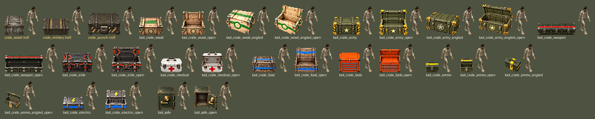
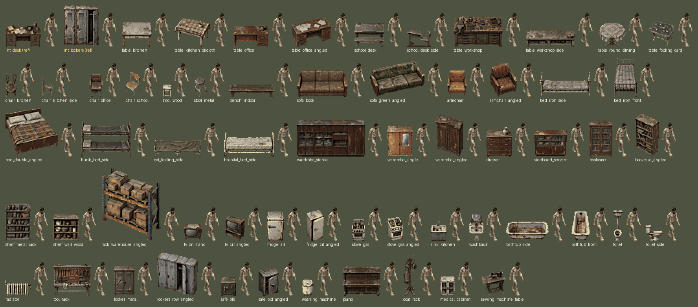
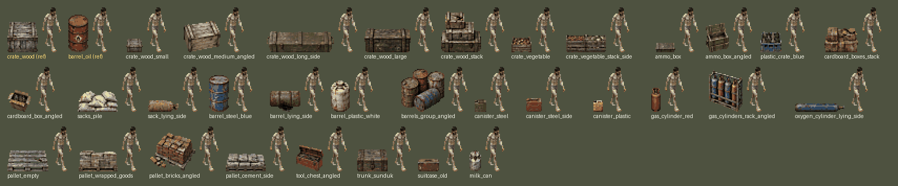
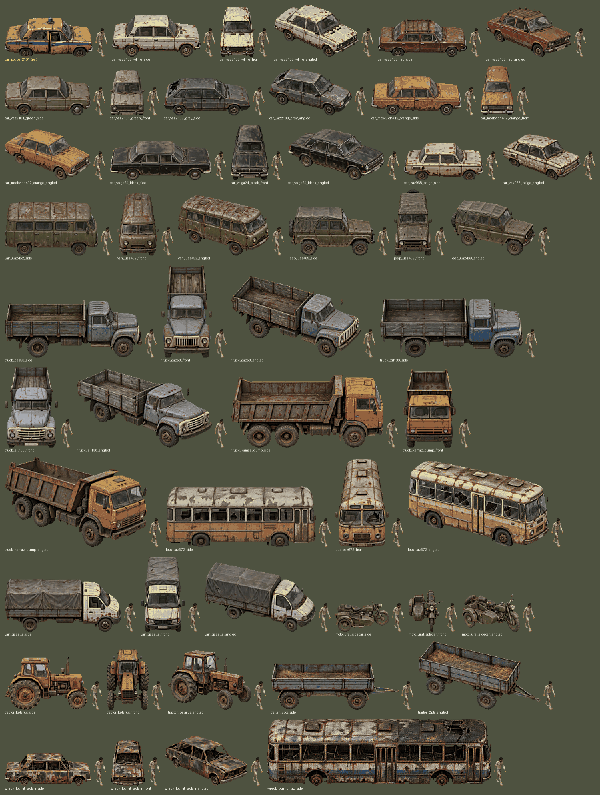
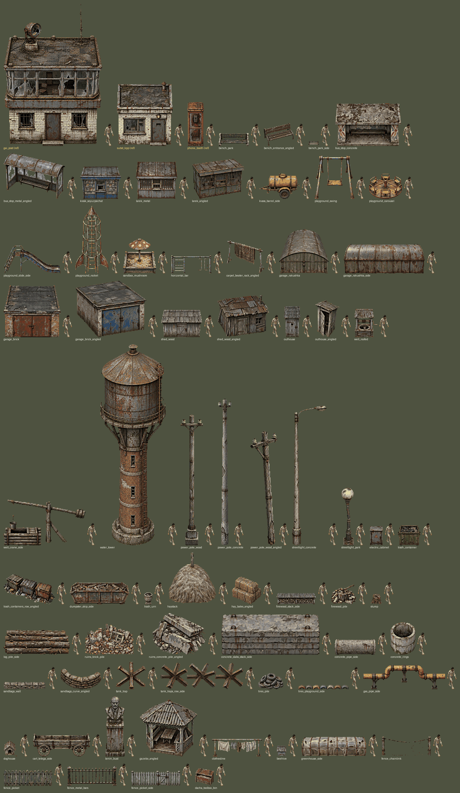
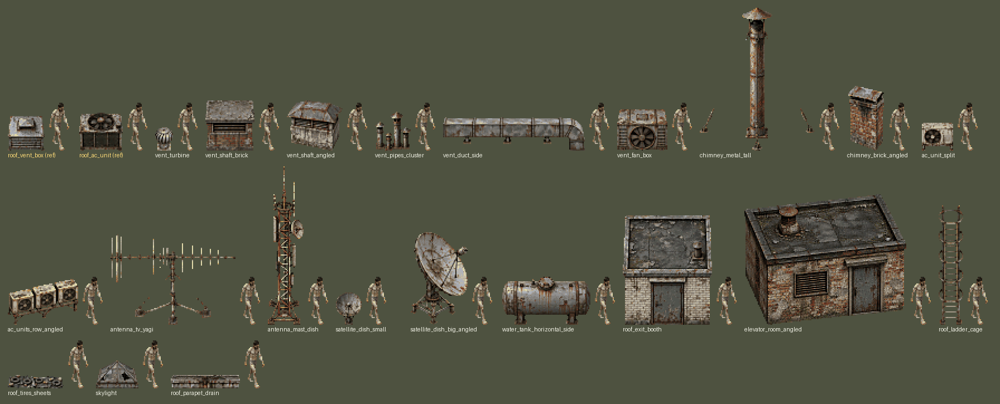
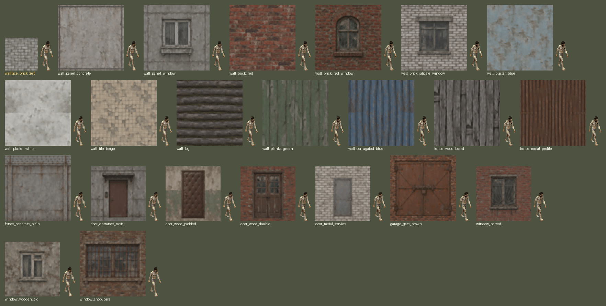
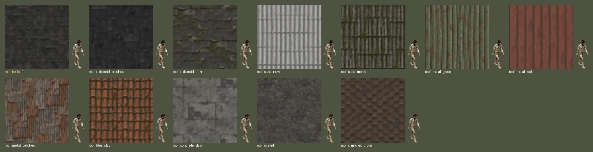
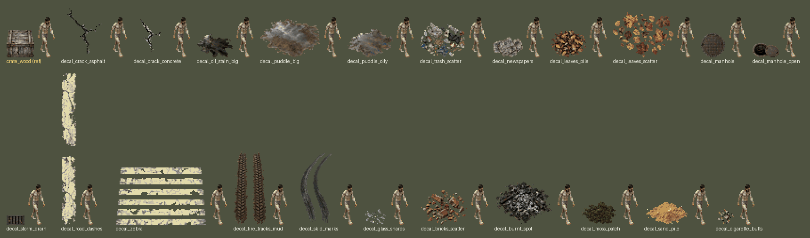

# Библиотека ассетов

Заготовки для открытого мира и РТ (просьба пользователя 2026-10-21: «миллион всего», понятное русскому человеку, ракурсы вперемешку). Сгенерированы Codex по `assets/manifest.json`, обработаны `scripts/process-assets.py` (32 px/м, общая палитра мира; лут — своя насыщенная палитра). Спрайты: `game/art/<категория>/<id>.png`, HD-превью: `assets/hd/…`.

## Правила

- **Ракурсы** (`view`): `front` — объект лицом к камере; `side` — точный профиль, длинная ось горизонтальна; `angled` — объект повёрнут на ~30° вокруг вертикали, камера всё так же с юга под ~50° (не изометрия 45°). Текст кадра — `front_framing` / `side_framing` / `angled_framing` в манифесте. Распределение в библиотеке (без тайлов и декалей): прямо 107 (47%), сбоку 63 (27%), под 30° 60 (26%).
- **Масштаб**: `w` — реальная видимая ширина в метрах для этого ракурса (у `angled` ≈ ширина·cos30° + глубина·sin30°); высота спрайта получается из пропорций картинки. `foot` — хитбокс [ширина, глубина, высота укрытия] или `{"legs": …}` для объектов на опорах. Для высоких тонких объектов (столбы, фонари) `w` подобран так, чтобы высота была реальной (8–9 м).
- **Проверка размеров**: контактные листы в масштабе игры (×2, nearest) — рядом с каждым предметом человек 1,8 м (`char_naked_f0` ×0,8, как в игре), жёлтым подписаны эталоны из игры (ГАИ 6 м, КПП 3,4 м, милицейская «копейка», `int_desk` и т. п.).
- Стены с дверью/окном посередине обработаны без «бесшовного» сдвига (иначе проём разрезался на четыре угла); дверь 0,9–1,4 × 2,1 м в куске стены 2,5 м.
- Машины, развёрнутые не в ту сторону, можно отражать по горизонтали.

## Поправки после контактных листов

- rack_warehouse_angled 2.85→2.4; fridge_zil_angled 0.83→0.7; bed_double_angled 2.39→2.1; barrels_group_angled 1.6→1.3; gas_cylinders_rack_angled 1.3→1.0
- vehicles: all *_angled w ×0.9 (wheels/cabs looked larger than on side views)
- power_pole_wood/concrete/wood_angled, streetlight_concrete: regenerated (were squat) and w set from real height 8/9/7/8.5 m; streetlight_park 0.5→0.74 (h 3.5); chimney_metal_tall 0.6→3.2 (guy wires); antenna_tv_yagi 1.5→3.5; garage_brick_angled 6.03→4.3; hay_bales_angled 2.4→1.8; tank_trap regenerated
- decal_road_dashes 3.0→0.5, decal_tire_tracks_mud 3.0→1.1, decal_skid_marks 2.5→1.2 (generated vertical, w was meant as length)
- walls with a door/window/panel frame (13) processed without the seamless half-shift (it split openings into corners)
- `loot_safe_open` 0.8→1.05 (открытая дверца добавляет ширины).

## Лут-контейнеры (крейты) — 26

| id | что | вид | ширина, м | foot |
|---|---|---|---|---|
| `loot_crate_wood` | a tier-0 supply crate of light fresh pine planks with a bright green painted band around it, thick rope handle… | прямо | 1.1 | [1.1, 0.77, 0.9] |
| `loot_crate_wood_open` | (открытый, пустой) a tier-0 supply crate of light fresh pine planks with a bright green painted band around it… | прямо | 1.1 | [1.1, 0.77, 0.9] |
| `loot_crate_wood_angled` | a tier-0 supply crate of light fresh pine planks with a bright green painted band around it, thick rope handle… | под 30° | 1.34 | [1.1, 0.77, 0.9] |
| `loot_crate_wood_angled_open` | (открытый, пустой) a tier-0 supply crate of light fresh pine planks with a bright green painted band around it… | под 30° | 1.34 | [1.1, 0.77, 0.9] |
| `loot_crate_army` | a tier-1 olive-green military crate with bright yellow-and-black hazard-striped corners, heavy steel latches a… | прямо | 1.3 | [1.3, 0.91, 0.9] |
| `loot_crate_army_open` | (открытый, пустой) a tier-1 olive-green military crate with bright yellow-and-black hazard-striped corners, he… | прямо | 1.3 | [1.3, 0.91, 0.9] |
| `loot_crate_army_angled` | a tier-1 olive-green military crate with bright yellow-and-black hazard-striped corners, heavy steel latches a… | под 30° | 1.58 | [1.3, 0.91, 0.9] |
| `loot_crate_army_angled_open` | (открытый, пустой) a tier-1 olive-green military crate with bright yellow-and-black hazard-striped corners, he… | под 30° | 1.58 | [1.3, 0.91, 0.9] |
| `loot_crate_weapon` | a tier-2 long dark-green weapon case with a bright red stripe along it, three heavy chrome latches and reinfor… | прямо | 1.8 | [1.8, 1.26, 0.7] |
| `loot_crate_weapon_open` | (открытый, пустой) a tier-2 long dark-green weapon case with a bright red stripe along it, three heavy chrome … | прямо | 1.8 | [1.8, 1.26, 0.7] |
| `loot_crate_elite` | a tier-3 heavy armoured steel crate, dark gunmetal with glowing orange-red seams, a lock panel with a small gl… | прямо | 1.4 | [1.4, 0.98, 0.9] |
| `loot_crate_elite_open` | (открытый, пустой) a tier-3 heavy armoured steel crate, dark gunmetal with glowing orange-red seams, a lock pa… | прямо | 1.4 | [1.4, 0.98, 0.9] |
| `loot_crate_medical` | a white metal medical box with a big bright red cross on the front, steel latches and a carry handle, closed | прямо | 1.0 | [1.0, 0.7, 0.8] |
| `loot_crate_medical_open` | (открытый, пустой) a white metal medical box with a big bright red cross on the front, steel latches and a car… | прямо | 1.0 | [1.0, 0.7, 0.8] |
| `loot_crate_food` | a slatted wooden food crate with a bright blue painted band, sacks and tin cans visible through the gaps betwe… | прямо | 1.1 | [1.1, 0.77, 0.9] |
| `loot_crate_food_open` | (открытый, пустой) a slatted wooden food crate with a bright blue painted band, sacks and tin cans visible thr… | прямо | 1.1 | [1.1, 0.77, 0.9] |
| `loot_crate_tools` | a bright orange metal tool chest with several drawers with chrome handles and a lift-up lid, closed | прямо | 1.0 | [1.0, 0.7, 0.9] |
| `loot_crate_tools_open` | (открытый, пустой) a bright orange metal tool chest with several drawers with chrome handles and a lift-up lid | прямо | 1.0 | [1.0, 0.7, 0.9] |
| `loot_crate_ammo` | a small steel ammunition box painted dark green with a bright yellow band and a chrome clamp latch, closed | прямо | 0.6 | [0.6, 0.42, 0.5] |
| `loot_crate_ammo_open` | (открытый, пустой) a small steel ammunition box painted dark green with a bright yellow band and a chrome clam… | прямо | 0.6 | [0.6, 0.42, 0.5] |
| `loot_crate_ammo_angled` | a small steel ammunition box painted dark green with a bright yellow band and a chrome clamp latch, closed, tu… | под 30° | 0.73 | [0.6, 0.42, 0.5] |
| `loot_crate_ammo_angled_open` | (открытый, пустой) a small steel ammunition box painted dark green with a bright yellow band and a chrome clam… | под 30° | 0.73 | [0.6, 0.42, 0.5] |
| `loot_crate_electric` | a grey metal box for electrical parts with a big yellow lightning-bolt symbol, a bright blue band and steel la… | прямо | 1.0 | [1.0, 0.7, 0.8] |
| `loot_crate_electric_open` | (открытый, пустой) a grey metal box for electrical parts with a big yellow lightning-bolt symbol, a bright blu… | прямо | 1.0 | [1.0, 0.7, 0.8] |
| `loot_safe` | a chunky old Soviet steel safe painted dark green with a shiny gold-coloured dial and a brass handle, closed | прямо | 0.8 | [0.8, 0.56, 1.0] |
| `loot_safe_open` | (открытый, пустой) a chunky old Soviet steel safe painted dark green with a shiny gold-coloured dial and a bra… | прямо | 1.05 | [0.8, 0.56, 1.0] |

## Мебель и интерьер — 60

| id | что | вид | ширина, м | foot |
|---|---|---|---|---|
| `table_kitchen` | a Soviet kitchen table with a light grey patterned formica top, thin metal edging and tapered wooden legs, a d… | прямо | 1.2 | [1.2, 0.7, 0.75] |
| `table_kitchen_oilcloth` | a wooden kitchen table covered with a faded checkered oilcloth, a chipped enamel mug on it, turned about 30 de… | под 30° | 1.44 | [1.2, 0.8, 0.75] |
| `table_office` | a Soviet office desk of polished brown wood veneer with a drawer pedestal on the right, scratched top, a dusty… | прямо | 1.4 | [1.4, 0.7, 0.75] |
| `table_office_angled` | a Soviet office desk of brown wood veneer with drawer pedestals on both sides, scattered papers, turned about … | под 30° | 1.56 | [1.4, 0.7, 0.75] |
| `school_desk` | a Soviet two-seat school desk (parta) with a slanted green-painted writing top and an attached bench, cast-iro… | прямо | 1.2 | [1.2, 0.9, 0.8] |
| `school_desk_side` | a Soviet school desk (parta) with attached bench seen in exact side profile: the cast-iron side frame, slanted… | сбоку | 0.95 | [0.95, 1.2, 0.8] |
| `table_workshop` | a heavy steel workshop bench with a thick worn wooden top, a large bench vise, drawers, oil stains, a few tool… | прямо | 2.0 | [2.0, 0.8, 0.9] |
| `table_workshop_side` | a long welded steel workshop table seen in exact side profile, a vise at the right end, a shelf underneath wit… | сбоку | 2.0 | [2.0, 0.8, 0.9] |
| `table_round_dining` | a round polished wooden dining table on a central pedestal leg covered with a lace tablecloth, dusty | прямо | 1.1 | [1.1, 1.1, 0.75] |
| `table_folding_card` | a small folding table with a green felt top and wobbly legs, dominoes scattered on it, turned about 30 degrees | под 30° | 1.08 | [0.9, 0.6, 0.7] |
| `chair_kitchen` | a bentwood Viennese-style wooden kitchen chair with a round seat and curved back, worn dark varnish | прямо | 0.45 | [0.45, 0.45, 0.9] |
| `chair_kitchen_side` | a simple wooden kitchen chair seen in exact side profile: the backrest on the left, seat and four legs | сбоку | 0.45 | [0.45, 0.45, 0.9] |
| `chair_office` | a Soviet office chair with a padded brown leatherette seat and backrest and wooden armrests, torn padding | прямо | 0.55 | [0.55, 0.55, 0.95] |
| `chair_school` | a Soviet school chair of bent steel tube with plywood seat and backrest, chipped paint, turned about 30 degree… | под 30° | 0.57 | [0.42, 0.42, 0.8] |
| `stool_wood` | a simple square wooden stool (taburetka) with four legs and cross braces, painted white long ago, paint worn o… | прямо | 0.35 | [0.35, 0.35, 0.45] |
| `stool_metal` | a round metal workshop stool on three tube legs with a cracked dark seat, turned about 30 degrees | под 30° | 0.52 | [0.38, 0.38, 0.5] |
| `bench_indoor` | a long plain wooden bench (lavka) of thick boards on two plank legs, painted dark brown, worn | сбоку | 1.8 | [1.8, 0.4, 0.45] |
| `sofa_book` | a Soviet fold-out sofa-book with brown patterned upholstery and wooden armrests, sagging seat, a torn cushion | прямо | 2.0 | [2.0, 0.9, 0.9] |
| `sofa_green_angled` | a worn Soviet sofa with faded green velour upholstery and polished wooden armrests, turned about 30 degrees | под 30° | 2.18 | [2.0, 0.9, 0.9] |
| `armchair` | a Soviet 1970s armchair with thin splayed wooden legs, wooden armrests and faded mustard-yellow upholstery | прямо | 0.8 | [0.8, 0.8, 0.9] |
| `armchair_angled` | a worn Soviet armchair with faded red-brown upholstery and wooden armrests, turned about 30 degrees | под 30° | 1.09 | [0.8, 0.8, 0.9] |
| `bed_iron_side` | a Soviet iron spring-mesh bed (pantsirnaya krovat) with chrome ball-tipped headboards, a thin striped mattress… | сбоку | 2.0 | [2.0, 0.9, 0.6] |
| `bed_iron_front` | a Soviet iron spring-mesh bed with ball-tipped tube headboards and a thin striped mattress, the foot end faces… | прямо | 0.9 | [0.9, 2.0, 0.6] |
| `bed_double_angled` | a polished wooden Soviet double bed with a plaid blanket and two pillows, turned about 30 degrees | под 30° | 2.1 | [1.6, 2.0, 0.6] |
| `bunk_bed_side` | a Soviet army two-tier steel bunk bed with thin grey wool blankets, seen in exact side profile | сбоку | 2.0 | [2.0, 0.8, 1.7] |
| `cot_folding_side` | a folding camp cot (raskladushka) of aluminium tubes and faded green canvas, seen in exact side profile | сбоку | 1.9 | [1.9, 0.7, 0.4] |
| `hospital_bed_side` | an old Soviet hospital bed of white-painted steel tubes on small wheels, chipped paint, a stained mattress, se… | сбоку | 2.0 | [2.0, 0.9, 0.7] |
| `wardrobe_stenka` | a Soviet polished wooden wall unit (stenka) with glass cabinets of crystal dishes, wardrobe doors and drawers,… | прямо | 2.7 | [2.7, 0.5, 2.1] |
| `wardrobe_single` | a Soviet two-door wooden wardrobe of light brown veneer with a small mirror on one door, scratched | прямо | 1.0 | [1.0, 0.55, 1.9] |
| `wardrobe_angled` | a tall old two-door wooden wardrobe with a carved top, dark varnish, turned about 30 degrees | под 30° | 1.14 | [1.0, 0.55, 1.9] |
| `dresser` | a Soviet chest of drawers (komod) of brown veneer with four drawers and metal handles, a doily and a vase on t… | прямо | 1.0 | [1.0, 0.45, 0.85] |
| `sideboard_servant` | a Soviet sideboard (servant) with sliding glass doors showing dusty plates and crystal, cupboards below | прямо | 1.3 | [1.3, 0.45, 1.8] |
| `bookcase` | a tall wooden bookcase with glass doors filled with rows of old books with plain spines, dusty | прямо | 0.9 | [0.9, 0.35, 2.0] |
| `bookcase_angled` | a tall open wooden bookshelf with sagging shelves of old books and folders, turned about 30 degrees | под 30° | 0.95 | [0.9, 0.35, 2.0] |
| `shelf_metal_rack` | a grey steel storage rack with five shelves holding jars, tins, boxes and rags | прямо | 1.0 | [1.0, 0.4, 2.0] |
| `shelf_wall_wood` | a low wooden open shelf unit with three shelves of pots, jars and a radio | прямо | 1.0 | [1.0, 0.3, 1.2] |
| `rack_warehouse_angled` | a tall orange-blue steel pallet rack with two levels of pallets with boxes, turned about 30 degrees | под 30° | 2.4 | [2.7, 1.0, 3.0] |
| `tv_on_stand` | an old Soviet tube television (Rubin) with a wooden case on a thin-legged stand, dusty grey screen, a lace doi… | прямо | 0.7 | [0.7, 0.5, 1.2] |
| `tv_crt_angled` | an old boxy Soviet television in a wood-grain case standing on a small cabinet, cracked screen, turned about 3… | под 30° | 0.77 | [0.6, 0.5, 1.1] |
| `fridge_zil` | an old Soviet ZIL refrigerator with rounded corners, white enamel yellowed with age, a big chrome lever handle | прямо | 0.65 | [0.65, 0.6, 1.5] |
| `fridge_zil_angled` | an old rounded Soviet refrigerator with yellowed white enamel and a chrome handle, door slightly open, turned … | под 30° | 0.7 | [0.65, 0.6, 1.5] |
| `stove_gas` | a Soviet four-burner white enamel gas stove with an oven door, grease stains, a dented kettle on a burner | прямо | 0.5 | [0.5, 0.55, 0.85] |
| `stove_gas_angled` | a Soviet white enamel gas stove with four burners, a frying pan on top, turned about 30 degrees | под 30° | 0.71 | [0.5, 0.55, 0.85] |
| `sink_kitchen` | a chipped white enamel kitchen sink on a painted cabinet with a tall chrome tap, rusty stains | прямо | 0.6 | [0.6, 0.5, 0.85] |
| `washbasin` | a bathroom washbasin on a pedestal with a cracked small mirror above it, rusty tap | прямо | 0.55 | [0.55, 0.45, 0.85] |
| `bathtub_side` | an old cast-iron enamel bathtub on small legs, chipped white enamel with rust stains, seen in exact side profi… | сбоку | 1.7 | [1.7, 0.75, 0.6] |
| `bathtub_front` | an old cast-iron white enamel bathtub, the narrow end faces the viewer and the tub extends away from the camer… | прямо | 0.75 | [0.75, 1.7, 0.6] |
| `toilet` | an old Soviet toilet bowl with a high-mounted cistern on a pipe and a chain pull, stained porcelain | прямо | 0.4 | [0.4, 0.65, 0.8] |
| `toilet_side` | an old porcelain toilet with a cistern seen in exact side profile, stained, cracked seat | сбоку | 0.65 | [0.65, 0.4, 0.8] |
| `radiator` | a Soviet cast-iron accordion heating radiator with many sections, painted off-white, peeling, on a pipe | прямо | 1.0 | [1.0, 0.15, 0.6] |
| `tool_rack` | a wall tool board of plywood on legs with hanging hammers, saws, wrenches, pliers and coils of wire | прямо | 1.5 | [1.5, 0.3, 1.8] |
| `locker_metal` | a grey-green steel two-door locker with vent slits and a padlock, dented | прямо | 0.8 | [0.8, 0.5, 1.8] |
| `lockers_row_angled` | a row of four narrow steel changing-room lockers painted pale blue, one door open, turned about 30 degrees | под 30° | 1.64 | [1.6, 0.5, 1.8] |
| `safe_old` | a heavy old Soviet steel safe painted dark green with a big key lock and a handle, scratched | прямо | 0.6 | [0.6, 0.6, 1.0] |
| `safe_old_angled` | a heavy old steel safe painted grey with the door ajar, turned about 30 degrees | под 30° | 0.82 | [0.6, 0.6, 1.0] |
| `washing_machine` | a Soviet round-tub washing machine (Riga / Malyutka style), white enamel with a lid and a hose, chipped | прямо | 0.5 | [0.5, 0.5, 0.85] |
| `piano` | an old upright piano of dark polished wood with the keyboard lid closed, scratches, a candleholder | прямо | 1.5 | [1.5, 0.6, 1.3] |
| `coat_rack` | a wooden standing coat rack with an old coat and a fur hat hanging on it | прямо | 0.55 | [0.5, 0.5, 1.8] |
| `medical_cabinet` | an old white-painted steel medical cabinet with glass doors and a few bottles inside, chipped paint | прямо | 0.6 | [0.6, 0.4, 1.7] |
| `sewing_machine_table` | an old black Podolsk treadle sewing machine on a cast-iron table, turned about 30 degrees | под 30° | 1.0 | [0.9, 0.45, 0.8] |

## Тара (декор: ящики, бочки, канистры, баллоны, паллеты) — 32

| id | что | вид | ширина, м | foot |
|---|---|---|---|---|
| `crate_wood_small` | a small wooden crate of rough grey planks with rope handles | прямо | 0.5 | [0.5, 0.4, 0.4] |
| `crate_wood_medium_angled` | a medium wooden crate of pale pine planks with metal corner straps, turned about 30 degrees | под 30° | 1.08 | [0.9, 0.6, 0.6] |
| `crate_wood_long_side` | a long narrow wooden military crate painted olive green with rope handles and latches, seen in exact side prof… | сбоку | 2.0 | [2.0, 0.5, 0.45] |
| `crate_wood_large` | a large heavy wooden shipping crate of dark weathered planks with stencil marks worn off | сбоку | 1.4 | [1.4, 1.0, 1.1] |
| `crate_wood_stack` | a stack of three wooden crates of different sizes, slightly offset, one lid broken | прямо | 1.2 | [1.2, 0.8, 1.6] |
| `crate_vegetable` | a slatted wooden vegetable crate with some rotten potatoes and onions | прямо | 0.6 | [0.6, 0.4, 0.3] |
| `crate_vegetable_stack_side` | two stacks of slatted wooden vegetable crates side by side, seen in exact side profile | сбоку | 1.2 | [1.2, 0.4, 0.9] |
| `ammo_box` | a green-painted wooden Soviet ammunition box with rope handles and metal latches | прямо | 0.6 | [0.6, 0.35, 0.3] |
| `ammo_box_angled` | two stacked green-painted wooden ammunition boxes with rope handles, the top lid open, turned about 30 degrees | под 30° | 0.69 | [0.6, 0.35, 0.6] |
| `plastic_crate_blue` | a blue plastic crate with empty glass bottles in it, scratched and dirty | прямо | 0.6 | [0.6, 0.4, 0.3] |
| `cardboard_boxes_stack` | a stack of brown cardboard boxes, wet and sagging, one torn open | прямо | 1.0 | [1.0, 0.6, 1.1] |
| `cardboard_box_angled` | a single brown cardboard box with flaps open and junk inside, turned about 30 degrees | под 30° | 0.72 | [0.6, 0.4, 0.4] |
| `sacks_pile` | a pile of white woven polypropylene sacks of flour and sugar, one split | прямо | 1.2 | [1.2, 0.8, 0.8] |
| `sack_lying_side` | a single full burlap sack lying on its side, tied with string, seen in exact side profile | сбоку | 0.9 | [0.9, 0.5, 0.35] |
| `barrel_steel_blue` | a 200-litre steel drum painted faded blue, dented, rust rings | прямо | 0.6 | [0.6, 0.6, 0.9] |
| `barrel_lying_side` | a rusty 200-litre steel drum lying on its side, seen in exact side profile, a puddle of dark oil | сбоку | 0.9 | [0.9, 0.6, 0.6] |
| `barrel_plastic_white` | a dirty white plastic chemical barrel with a screw cap | прямо | 0.55 | [0.55, 0.55, 0.85] |
| `barrels_group_angled` | a group of four steel drums of different colours, rusty, one tipped over, turned about 30 degrees | под 30° | 1.3 | [1.5, 1.2, 0.9] |
| `canister_steel` | a 20-litre steel jerrycan painted faded green, dented, with a three-handle top | прямо | 0.35 | [0.35, 0.2, 0.47] |
| `canister_steel_side` | a 20-litre steel jerrycan painted red, seen in exact side profile, the cap on top | сбоку | 0.47 | [0.47, 0.2, 0.35] |
| `canister_plastic` | a translucent plastic fuel canister with a yellowish tint and a black cap | прямо | 0.3 | [0.3, 0.2, 0.4] |
| `gas_cylinder_red` | a red Soviet 50-litre propane gas cylinder with a brass valve and a protective cap, chipped paint | прямо | 0.3 | [0.3, 0.3, 0.95] |
| `gas_cylinders_rack_angled` | a steel cage rack holding four blue and red gas cylinders, turned about 30 degrees | под 30° | 1.0 | [1.2, 0.5, 1.5] |
| `oxygen_cylinder_lying_side` | a long blue oxygen gas cylinder lying on the ground, seen in exact side profile | сбоку | 1.5 | [1.5, 0.25, 0.25] |
| `pallet_empty` | an empty wooden euro pallet, grey weathered boards, a broken plank | прямо | 1.2 | [1.2, 0.8, 0.15] |
| `pallet_wrapped_goods` | a wooden pallet stacked with boxes wrapped in dirty stretch film | сбоку | 1.2 | [1.2, 0.8, 1.3] |
| `pallet_bricks_angled` | a wooden pallet stacked with red bricks, some fallen off, turned about 30 degrees | под 30° | 1.37 | [1.0, 1.0, 1.0] |
| `pallet_cement_side` | a wooden pallet with grey paper cement bags, a few torn and hardened, seen in exact side profile | сбоку | 1.2 | [1.2, 0.8, 0.9] |
| `tool_chest_angled` | a red metal tool chest with an open lid and tools inside, turned about 30 degrees | под 30° | 0.81 | [0.7, 0.4, 0.5] |
| `trunk_sunduk` | an old wooden chest (sunduk) bound with iron straps, a big padlock | прямо | 0.9 | [0.9, 0.5, 0.6] |
| `suitcase_old` | an old brown fibreboard suitcase standing upright, metal corners, a broken latch | прямо | 0.6 | [0.6, 0.2, 0.4] |
| `milk_can` | an aluminium Soviet milk can (bidon) with a lid clamp, dented and dull | прямо | 0.35 | [0.35, 0.35, 0.6] |

## Транспорт — 50

| id | что | вид | ширина, м | foot |
|---|---|---|---|---|
| `car_vaz2106_white_side` | an abandoned Soviet Lada VAZ-2106 Zhiguli sedan, boxy, faded white paint with rust on the sills and wheel arch… | сбоку | 4.17 | [4.17, 1.61, 1.44] |
| `car_vaz2106_white_front` | an abandoned Soviet Lada VAZ-2106 Zhiguli sedan, boxy, faded white paint with rust on the sills and wheel arch… | прямо | 1.61 | [1.61, 4.17, 1.44] |
| `car_vaz2106_white_angled` | an abandoned Soviet Lada VAZ-2106 Zhiguli sedan, boxy, faded white paint with rust on the sills and wheel arch… | под 30° | 3.98 | [3.3, 2.9, 1.44] |
| `car_vaz2106_red_side` | an abandoned Soviet Lada VAZ-2106 Zhiguli sedan, faded cherry-red paint, one flat tire, a cracked windshield, … | сбоку | 4.17 | [4.17, 1.61, 1.44] |
| `car_vaz2106_red_angled` | an abandoned Soviet Lada VAZ-2106 Zhiguli sedan, faded cherry-red paint, one flat tire, a cracked windshield, … | под 30° | 3.98 | [3.3, 2.9, 1.44] |
| `car_vaz2101_green_side` | an old Soviet Lada VAZ-2101 Kopeyka sedan, faded pale green paint, round headlights, rust patches, a missing h… | сбоку | 4.07 | [4.07, 1.61, 1.44] |
| `car_vaz2101_green_front` | an old Soviet Lada VAZ-2101 Kopeyka sedan, faded pale green paint, round headlights, rust patches, a missing h… | прямо | 1.61 | [1.61, 4.07, 1.44] |
| `car_vaz2109_grey_side` | an abandoned Lada VAZ-2109 hatchback (Devyatka), wedge-shaped 1980s body, faded wet-asphalt grey paint, black … | сбоку | 4.0 | [4.0, 1.65, 1.4] |
| `car_vaz2109_grey_angled` | an abandoned Lada VAZ-2109 hatchback (Devyatka), wedge-shaped 1980s body, faded wet-asphalt grey paint, black … | под 30° | 3.86 | [3.2, 2.8, 1.4] |
| `car_moskvich412_orange_side` | an old Soviet Moskvich-412 sedan, faded orange paint, rectangular headlights, rust on the doors, dusty | сбоку | 4.25 | [4.25, 1.55, 1.48] |
| `car_moskvich412_orange_front` | an old Soviet Moskvich-412 sedan, faded orange paint, rectangular headlights, rust on the doors, dusty | прямо | 1.55 | [1.55, 4.25, 1.48] |
| `car_moskvich412_orange_angled` | an old Soviet Moskvich-412 sedan, faded orange paint, rectangular headlights, rust on the doors, dusty | под 30° | 4.01 | [3.4, 2.8, 1.48] |
| `car_volga24_black_side` | an old Soviet GAZ-24 Volga sedan, long and solid, faded black paint, chrome grille and bumpers, a deer-less ho… | сбоку | 4.74 | [4.74, 1.8, 1.49] |
| `car_volga24_black_front` | an old Soviet GAZ-24 Volga sedan, long and solid, faded black paint, chrome grille and bumpers, a deer-less ho… | прямо | 1.8 | [1.8, 4.74, 1.49] |
| `car_volga24_black_angled` | an old Soviet GAZ-24 Volga sedan, long and solid, faded black paint, chrome grille and bumpers, a deer-less ho… | под 30° | 4.5 | [3.8, 3.2, 1.49] |
| `car_zaz968_beige_side` | a tiny old Soviet ZAZ-968 Zaporozhets car with side air intakes 'ears', faded beige paint, rust, flat tires | сбоку | 3.73 | [3.73, 1.57, 1.4] |
| `car_zaz968_beige_angled` | a tiny old Soviet ZAZ-968 Zaporozhets car with side air intakes 'ears', faded beige paint, rust, flat tires | под 30° | 3.62 | [3.0, 2.7, 1.4] |
| `van_uaz452_side` | an old Soviet UAZ-452 'Bukhanka' van, loaf-shaped rounded body, faded army olive-green paint, small round head… | сбоку | 4.36 | [4.36, 1.94, 2.06] |
| `van_uaz452_front` | an old Soviet UAZ-452 'Bukhanka' van, loaf-shaped rounded body, faded army olive-green paint, small round head… | прямо | 1.94 | [1.94, 4.36, 2.06] |
| `van_uaz452_angled` | an old Soviet UAZ-452 'Bukhanka' van, loaf-shaped rounded body, faded army olive-green paint, small round head… | под 30° | 4.28 | [3.5, 3.2, 2.06] |
| `jeep_uaz469_side` | an old Soviet UAZ-469 off-road jeep with a faded green canvas top, spare wheel on the back, scratched olive pa… | сбоку | 4.03 | [4.03, 1.79, 2.0] |
| `jeep_uaz469_front` | an old Soviet UAZ-469 off-road jeep with a faded green canvas top, spare wheel on the back, scratched olive pa… | прямо | 1.79 | [1.79, 4.03, 2.0] |
| `jeep_uaz469_angled` | an old Soviet UAZ-469 off-road jeep with a faded green canvas top, spare wheel on the back, scratched olive pa… | под 30° | 3.94 | [3.2, 3.0, 2.0] |
| `truck_gaz53_side` | an old Soviet GAZ-53 truck with a rounded cab and a wooden-plank cargo bed, faded blue cab, rusty fenders | сбоку | 6.4 | [6.4, 2.38, 2.2] |
| `truck_gaz53_front` | an old Soviet GAZ-53 truck with a rounded cab and a wooden-plank cargo bed, faded blue cab, rusty fenders | прямо | 2.38 | [2.38, 6.4, 2.2] |
| `truck_gaz53_angled` | an old Soviet GAZ-53 truck with a rounded cab and a wooden-plank cargo bed, faded blue cab, rusty fenders | под 30° | 6.06 | [5.1, 4.3, 2.2] |
| `truck_zil130_side` | an old Soviet ZIL-130 truck, wide cab with a long hood and big grille, faded light blue cab and a grey wooden … | сбоку | 6.7 | [6.7, 2.5, 2.4] |
| `truck_zil130_front` | an old Soviet ZIL-130 truck, wide cab with a long hood and big grille, faded light blue cab and a grey wooden … | прямо | 2.5 | [2.5, 6.7, 2.4] |
| `truck_zil130_angled` | an old Soviet ZIL-130 truck, wide cab with a long hood and big grille, faded light blue cab and a grey wooden … | под 30° | 6.34 | [5.4, 4.5, 2.4] |
| `truck_kamaz_dump_side` | an old Soviet KamAZ-5511 dump truck, flat-nosed cab-over orange cab, a rusty steel dump body, big dual rear wh… | сбоку | 7.1 | [7.1, 2.5, 2.9] |
| `truck_kamaz_dump_front` | an old Soviet KamAZ-5511 dump truck, flat-nosed cab-over orange cab, a rusty steel dump body, big dual rear wh… | прямо | 2.5 | [2.5, 7.1, 2.9] |
| `truck_kamaz_dump_angled` | an old Soviet KamAZ-5511 dump truck, flat-nosed cab-over orange cab, a rusty steel dump body, big dual rear wh… | под 30° | 6.66 | [5.7, 4.6, 2.9] |
| `bus_paz672_side` | an old Soviet PAZ-672 small bus, rounded body, faded yellow and cream paint, many side windows, some broken, f… | сбоку | 7.0 | [7.0, 2.5, 2.95] |
| `bus_paz672_front` | an old Soviet PAZ-672 small bus, rounded body, faded yellow and cream paint, many side windows, some broken, f… | прямо | 2.5 | [2.5, 7.0, 2.95] |
| `bus_paz672_angled` | an old Soviet PAZ-672 small bus, rounded body, faded yellow and cream paint, many side windows, some broken, f… | под 30° | 6.58 | [5.6, 4.6, 2.95] |
| `van_gazelle_side` | an old 1990s GAZelle light truck with a white cab and a grey canvas-covered cargo bed, rust on the doors | сбоку | 5.5 | [5.5, 2.1, 2.2] |
| `van_gazelle_front` | an old 1990s GAZelle light truck with a white cab and a grey canvas-covered cargo bed, rust on the doors | прямо | 2.1 | [2.1, 5.5, 2.2] |
| `van_gazelle_angled` | an old 1990s GAZelle light truck with a white cab and a grey canvas-covered cargo bed, rust on the doors | под 30° | 5.23 | [4.4, 3.8, 2.2] |
| `moto_ural_sidecar_side` | an old Soviet Ural heavy motorcycle with a sidecar, faded dark green paint, round headlight, torn seat, rusty … | сбоку | 2.55 | [2.55, 1.6, 1.1] |
| `moto_ural_sidecar_front` | an old Soviet Ural heavy motorcycle with a sidecar, faded dark green paint, round headlight, torn seat, rusty … | прямо | 1.6 | [1.6, 2.55, 1.1] |
| `moto_ural_sidecar_angled` | an old Soviet Ural heavy motorcycle with a sidecar, faded dark green paint, round headlight, torn seat, rusty … | под 30° | 2.71 | [2.0, 2.4, 1.1] |
| `tractor_belarus_side` | an old Soviet Belarus MTZ-80 tractor, red-orange body with big rear wheels and smaller front wheels, a boxy ca… | сбоку | 3.9 | [3.9, 1.97, 2.8] |
| `tractor_belarus_front` | an old Soviet Belarus MTZ-80 tractor, red-orange body with big rear wheels and smaller front wheels, a boxy ca… | прямо | 1.97 | [1.97, 3.9, 2.8] |
| `tractor_belarus_angled` | an old Soviet Belarus MTZ-80 tractor, red-orange body with big rear wheels and smaller front wheels, a boxy ca… | под 30° | 3.92 | [3.1, 3.1, 2.8] |
| `trailer_2pts_side` | an old Soviet two-axle agricultural tractor trailer with low steel sides, a drawbar in front, faded blue paint… | сбоку | 6.0 | [6.0, 2.4, 2.0] |
| `trailer_2pts_angled` | an old Soviet two-axle agricultural tractor trailer with low steel sides, a drawbar in front, faded blue paint… | под 30° | 5.76 | [4.8, 4.2, 2.0] |
| `wreck_burnt_sedan_side` | a completely burnt-out Soviet Zhiguli sedan wreck: blackened and orange-rusted bare metal, no glass, no tires,… | сбоку | 4.1 | [4.1, 1.62, 1.35] |
| `wreck_burnt_sedan_front` | a completely burnt-out Soviet Zhiguli sedan wreck: blackened and orange-rusted bare metal, no glass, no tires,… | прямо | 1.62 | [1.62, 4.1, 1.35] |
| `wreck_burnt_sedan_angled` | a completely burnt-out Soviet Zhiguli sedan wreck: blackened and orange-rusted bare metal, no glass, no tires,… | под 30° | 3.92 | [3.3, 2.8, 1.35] |
| `wreck_burnt_liaz_side` | a burnt-out Soviet LiAZ-677 city bus wreck, long rounded body, blackened rusty metal, all windows gone, sittin… | сбоку | 10.5 | [10.5, 2.5, 3.0] |

## Открытый мир — 67

| id | что | вид | ширина, м | foot |
|---|---|---|---|---|
| `bench_park` | a Soviet park bench with concrete legs and green-painted wooden slats, some slats broken | прямо | 1.8 | [1.8, 0.5, 0.5] |
| `bench_entrance_angled` | a bench by an apartment building entrance with curved metal legs and wooden slats painted brown, turned about … | под 30° | 1.81 | [1.8, 0.5, 0.5] |
| `bench_park_side` | a wooden park bench seen in exact side profile from its end: the cast-iron side leg and backrest outline | сбоку | 0.6 | [0.6, 1.8, 0.5] |
| `bus_stop_concrete` | a Soviet concrete bus stop shelter with a flat slab roof, side walls with a faded mosaic pattern, a bench insi… | прямо | 4.0 | опоры [4.0, 1.6, 2.6] |
| `bus_stop_metal_angled` | a metal bus stop shelter with broken glass panels and a curved roof, a bench, turned about 30 degrees | под 30° | 3.78 | опоры [3.5, 1.5, 2.5] |
| `kiosk_soyuzpechat` | a Soviet newspaper kiosk (Soyuzpechat): a small glazed box with a sloping roof overhang, blue frame, dusty win… | прямо | 2.5 | [2.5, 2.0, 2.6] |
| `larek_metal` | a 1990s steel street kiosk (larek) with a small barred window and a serving hatch, faded paint and rust, no te… | прямо | 2.5 | [2.5, 2.0, 2.5] |
| `larek_angled` | a 1990s steel street kiosk (larek) painted faded green with barred windows, turned about 30 degrees | под 30° | 3.17 | [2.5, 2.0, 2.5] |
| `kvass_barrel_side` | a Soviet yellow kvass barrel tank on a two-wheel trailer with a small tap, faded paint, rust, seen in exact si… | сбоку | 2.5 | [2.5, 1.3, 1.6] |
| `playground_swing` | a Soviet playground swing: a steel A-frame painted in faded colours with one seat hanging on rods | прямо | 2.4 | опоры [2.4, 1.2, 2.2] |
| `playground_carousel` | a round Soviet playground carousel with a steel deck and handrails, faded red and yellow paint | прямо | 2.0 | [2.0, 2.0, 0.9] |
| `playground_slide_side` | a Soviet metal playground slide with a ladder, faded blue paint, seen in exact side profile | сбоку | 3.5 | [3.5, 0.8, 2.2] |
| `playground_rocket` | a Soviet playground climbing frame shaped like a space rocket made of steel bars, faded red and silver paint | прямо | 2.0 | опоры [2.0, 2.0, 4.5] |
| `sandbox_mushroom` | a wooden playground sandbox with a mushroom-shaped painted parasol in the middle, faded red with white dots | прямо | 2.0 | [2.0, 2.0, 0.3] |
| `horizontal_bar` | a courtyard horizontal bar and carpet beater frame of steel pipes, peeling paint | сбоку | 2.5 | опоры [2.5, 0.3, 2.4] |
| `carpet_beater_rack_angled` | a Soviet courtyard pipe frame for beating carpets with a faded rug hanging over it, turned about 30 degrees | под 30° | 2.31 | опоры [2.5, 0.3, 2.0] |
| `garage_rakushka` | a Soviet steel 'rakushka' shell garage: a rounded corrugated metal hood over a car, faded green paint, a padlo… | прямо | 3.0 | [3.0, 5.0, 2.2] |
| `garage_rakushka_side` | a Soviet steel 'rakushka' shell garage, the rounded hood seen in exact side profile, faded paint, rust | сбоку | 5.0 | [5.0, 3.0, 2.2] |
| `garage_brick` | a Soviet single brick garage box with a flat ruberoid roof and closed steel double gates painted brown | прямо | 3.5 | [3.5, 6.0, 2.6] |
| `garage_brick_angled` | a Soviet single brick garage box with steel gates painted blue and a flat roof, turned about 30 degrees | под 30° | 4.3 | [3.5, 6.0, 2.6] |
| `shed_wood` | a village wooden shed (saray) of grey vertical boards with a slate roof and a padlocked door | прямо | 2.5 | [2.5, 2.0, 2.2] |
| `shed_wood_angled` | a lopsided wooden shed patched with sheet metal, a rusty corrugated roof, turned about 30 degrees | под 30° | 3.17 | [2.5, 2.0, 2.2] |
| `outhouse` | a wooden village outhouse with a heart-shaped hole in the door, grey boards, slate roof | прямо | 1.0 | [1.0, 1.2, 2.2] |
| `outhouse_angled` | a leaning wooden village outhouse painted faded green, door ajar, turned about 30 degrees | под 30° | 1.47 | [1.0, 1.2, 2.2] |
| `well_roofed` | a village log well with a small gable roof, a wooden windlass with a chain and a dented bucket | прямо | 1.4 | [1.2, 1.2, 1.0] |
| `well_crane_side` | a village shadoof well (zhuravl): a tall wooden pole with a long swinging beam and a bucket on a pole, a log w… | сбоку | 5.0 | [1.2, 1.2, 1.0] |
| `water_tower` | a Soviet Rozhnovsky water tower: a tall brick-and-steel column with a big rusty steel water tank and a cone ro… | прямо | 4.0 | [3.0, 3.0, 4.0] |
| `power_pole_wood` | a wooden power line pole with a crossarm and white porcelain insulators, a concrete stepped support at the bas… | прямо | 1.35 | [0.4, 0.4, 8] |
| `power_pole_concrete` | a grey concrete power line pole with a steel crossarm and glass insulators, chipped concrete | сбоку | 0.86 | [0.4, 0.4, 9] |
| `power_pole_wood_angled` | a leaning wooden power line pole with a crossarm and a strut, two insulators, turned about 30 degrees | под 30° | 1.61 | [0.4, 0.4, 7] |
| `streetlight_concrete` | a Soviet concrete street light pole with a curved arm and an old cobra-head lamp, the arm reaching to the righ… | прямо | 2.1 | [0.4, 0.4, 8] |
| `streetlight_park` | a cast-iron park lamp post with a round milky glass globe on top, slightly bent | прямо | 0.74 | [0.3, 0.3, 3.5] |
| `electric_cabinet` | a grey steel street electrical distribution cabinet with a lightning bolt sticker without text, rusty door | прямо | 0.8 | [0.8, 0.4, 1.4] |
| `trash_container` | a Soviet green steel garbage container with a sloped top opening, dented, overflowing with trash bags | прямо | 1.4 | [1.4, 1.0, 1.1] |
| `trash_containers_row_angled` | a row of three rusty steel garbage containers of different colours with trash around, turned about 30 degrees | под 30° | 3.1 | [3.0, 1.0, 1.1] |
| `dumpster_skip_side` | a big rusty steel construction skip (dumpster) full of broken bricks and boards, seen in exact side profile | сбоку | 3.6 | [3.6, 1.8, 1.2] |
| `trash_urn` | a Soviet concrete street trash urn shaped like a vase, chipped, with trash inside | прямо | 0.5 | [0.5, 0.5, 0.7] |
| `haystack` | a big village haystack (stog) with a pole sticking up from the top, greyish old hay | прямо | 3.0 | [3.0, 3.0, 3.0] |
| `hay_bales_angled` | a small stack of rectangular hay bales tied with twine, turned about 30 degrees | под 30° | 1.8 | [2.2, 1.2, 1.0] |
| `firewood_stack_side` | a long neat stack of split firewood logs (polennitsa) with a small slate roof, seen in exact side profile | сбоку | 2.5 | [2.5, 0.6, 1.4] |
| `firewood_pile` | a messy pile of chopped firewood with an axe stuck in a chopping block | прямо | 1.5 | [1.5, 1.0, 0.7] |
| `stump` | an old tree stump with rotten bark, moss and a few mushrooms | прямо | 0.7 | [0.6, 0.6, 0.5] |
| `log_pile_side` | a pile of long felled pine logs stacked on each other, seen in exact side profile | сбоку | 4.0 | [4.0, 1.5, 1.0] |
| `ruins_brick_pile` | a heap of rubble from a collapsed brick wall: broken red bricks, mortar chunks, a piece of window frame | прямо | 3.0 | [3.0, 2.0, 1.2] |
| `ruins_concrete_pile_angled` | a pile of broken concrete panel pieces with twisted rebar sticking out, turned about 30 degrees | под 30° | 3.5 | [3.2, 2.5, 1.5] |
| `concrete_slabs_stack_side` | a stack of four grey reinforced concrete road slabs with lifting loops, seen in exact side profile | сбоку | 6.0 | [6.0, 2.0, 0.9] |
| `concrete_pipe_side` | a large reinforced concrete drain pipe section lying on the ground, seen in exact side profile | сбоку | 2.5 | [2.5, 1.2, 1.2] |
| `concrete_rings` | two grey concrete well rings stacked on each other, chipped edges, moss | прямо | 1.5 | [1.5, 1.5, 1.8] |
| `sandbags_wall` | a straight low wall of stacked grey-green sandbags, some torn | сбоку | 2.5 | [2.5, 0.6, 1.0] |
| `sandbags_curve_angled` | a curved sandbag barricade of stacked sandbags, turned about 30 degrees | под 30° | 2.5 | [2.4, 1.2, 1.0] |
| `tank_trap` | a Czech hedgehog anti-tank obstacle (protivotankovy yozh) standing on the ground: three rusty steel I-beams we… | прямо | 1.8 | [1.4, 1.4, 1.2] |
| `tank_traps_row_side` | a row of three rusty steel anti-tank hedgehogs, seen in exact side profile | сбоку | 5.0 | [5.0, 1.2, 1.2] |
| `tires_pile` | a pile of old worn car tires | прямо | 1.5 | [1.5, 1.2, 0.9] |
| `tires_playground_side` | a row of old tires half buried in the ground, painted in faded colours as a courtyard fence, seen in exact sid… | сбоку | 3.0 | [3.0, 0.6, 0.6] |
| `gas_pipe_side` | a yellow-painted overground gas pipe on steel supports with a U-shaped raised arch, peeling paint, seen in exa… | сбоку | 5.0 | опоры [5.0, 0.3, 0.6] |
| `doghouse` | a village wooden dog kennel (budka) with a gable roof and a rusty chain | прямо | 0.9 | [0.9, 1.0, 0.9] |
| `cart_telega_side` | a village wooden horse cart (telega) with spoked wheels and plank sides, seen in exact side profile | сбоку | 3.5 | [3.5, 1.4, 1.0] |
| `lenin_bust` | a weathered concrete bust of a Soviet leader on a tall square pedestal, cracked, bird droppings, moss | прямо | 1.2 | [1.2, 1.2, 2.5] |
| `gazebo_angled` | a courtyard wooden gazebo (besedka) with a table and benches inside, a slate roof, peeling paint, turned about… | под 30° | 3.5 | опоры [3.0, 3.0, 2.5] |
| `clothesline` | a courtyard clothesline between two T-shaped metal posts with a few faded sheets and shirts hanging | сбоку | 3.0 | опоры [3.0, 0.2, 2.0] |
| `beehive` | a village wooden beehive box on legs, painted faded blue, a slanted roof | прямо | 0.6 | [0.6, 0.5, 0.8] |
| `greenhouse_side` | a dacha greenhouse of arched pipes covered with torn cloudy plastic film, seen in exact side profile | сбоку | 4.0 | [4.0, 2.5, 2.0] |
| `fence_chainlink` | a 3-metre section of chain-link mesh fence (rabitsa) stretched between two rusty steel posts, sagging, a hole … | прямо | 3.0 | опоры [3.0, 0.1, 2.0] |
| `fence_picket` | a 3-metre section of a village picket fence (shtaketnik) of narrow vertical pointed boards with gaps, faded gr… | прямо | 3.0 | опоры [3.0, 0.1, 1.4] |
| `fence_metal_bars` | a 3-metre section of a welded black steel bar fence with pointed tips between two square posts, rust, transpar… | сбоку | 3.0 | опоры [3.0, 0.1, 1.8] |
| `fence_picket_side` | a 3-metre section of a grey wooden picket fence with a small wicket gate, seen in exact side profile, transpar… | сбоку | 3.0 | опоры [3.0, 0.1, 1.4] |
| `dacha_toolbox_bin` | a sand bin box for winter roads, wooden, painted faded red, lid ajar, turned about 30 degrees | под 30° | 1.17 | [1.0, 0.6, 0.7] |

## Крыши: оборудование — 21

| id | что | вид | ширина, м | foot |
|---|---|---|---|---|
| `vent_turbine` | a rooftop rotating turbine ventilator: a galvanized ball of curved metal vanes on a short duct, standing on a … | прямо | 0.5 | [0.5, 0.5, 0.8] |
| `vent_shaft_brick` | a Soviet panel-house brick ventilation shaft with slatted openings and a concrete cap, standing on a flat roof | прямо | 1.4 | [1.4, 0.7, 1.4] |
| `vent_shaft_angled` | a concrete ventilation shaft block with louvered openings and a sheet metal hood, standing on a flat roof, tur… | под 30° | 1.56 | [1.4, 0.7, 1.4] |
| `vent_pipes_cluster` | a cluster of four thin sewer vent pipes of different heights sticking out of the roof with rain caps, standing… | прямо | 1.0 | [1.0, 0.6, 1.0] |
| `vent_duct_side` | a long galvanized ventilation duct running on small supports with an elbow at one end, standing on a flat roof… | сбоку | 4.0 | опоры [4.0, 0.6, 0.8] |
| `vent_fan_box` | a big industrial roof exhaust fan box with a round fan grille on the front and louvers, standing on a flat roo… | прямо | 1.4 | [1.4, 1.2, 1.0] |
| `chimney_metal_tall` | a tall thin rusty steel chimney pipe with a rain cap and three guy wires, soot at the top, standing on a flat … | прямо | 3.21 | [0.5, 0.5, 4.0] |
| `chimney_brick_angled` | a red brick chimney stack with a sheet metal cap, crumbling mortar and soot, standing on a flat roof, turned a… | под 30° | 1.08 | [0.9, 0.6, 1.6] |
| `ac_unit_split` | a dirty white outdoor air conditioner unit with a round fan grille on a steel bracket frame, standing on a fla… | прямо | 0.85 | [0.85, 0.35, 0.6] |
| `ac_units_row_angled` | a row of three old outdoor air conditioner units on a steel frame, yellowed plastic, standing on a flat roof, … | под 30° | 1.98 | [2.0, 0.5, 0.6] |
| `antenna_tv_yagi` | an old TV antenna: a long horizontal yagi with many crossbars on a rusty mast with guy wires, standing on a fl… | прямо | 3.5 | [0.3, 0.3, 3.0] |
| `antenna_mast_dish` | a tall lattice steel antenna mast with a small dish and whip antennas, standing on a flat roof | прямо | 1.02 | [0.6, 0.6, 4.0] |
| `satellite_dish_small` | a small grey satellite dish on a bracket, dirty, standing on a flat roof | прямо | 0.7 | [0.5, 0.5, 1.0] |
| `satellite_dish_big_angled` | a large old satellite dish on a steel stand with a feed arm, rust, standing on a flat roof, turned about 30 de… | под 30° | 1.6 | [1.4, 1.4, 1.8] |
| `water_tank_horizontal_side` | a horizontal cylindrical steel water tank on two cradle supports with a hatch on top, rust streaks, standing o… | сбоку | 2.5 | [2.5, 1.2, 1.5] |
| `roof_exit_booth` | a small brick roof exit booth with a flat roof and a steel door, on top of a Soviet apartment block, standing … | прямо | 2.5 | [2.5, 2.2, 2.5] |
| `elevator_room_angled` | a Soviet apartment block elevator machine room: a brick box with a flat ruberoid roof, a vent grille and a ste… | под 30° | 4.53 | [3.5, 3.0, 2.8] |
| `roof_ladder_cage` | a steel rooftop ladder with a safety cage of hoops, rusty, standing on a flat roof | прямо | 0.7 | [0.7, 0.3, 3.0] |
| `roof_tires_sheets` | old tires and bricks holding down loose sheets of ruberoid, standing on a flat roof | сбоку | 1.6 | [1.6, 1.2, 0.5] |
| `skylight` | a small pyramid glass skylight in a steel frame with some broken panes, standing on a flat roof | прямо | 1.2 | [1.2, 1.2, 0.5] |
| `roof_parapet_drain` | a low concrete roof parapet section with a rusty drain funnel and a puddle, standing on a flat roof, seen in e… | сбоку | 2.0 | [2.0, 0.4, 0.6] |

## Стены, заборы, двери, окна (тайлы фасада) — 22

| id | что | тайл, м |
|---|---|---|
| `wall_panel_concrete` | a Soviet prefabricated concrete apartment block panel, light grey with small pebble texture, dark sealed joint… | 3 |
| `wall_panel_window` | a Soviet prefab concrete apartment panel with one window in the middle: a white wooden double frame, dirty gla… | 3 |
| `wall_brick_red` | an old red brick wall, Soviet laying with darker burnt bricks, white efflorescence stains, crumbling mortar, n… | 3 |
| `wall_brick_red_window` | an old red brick wall with an arched-top window in the middle, a wooden frame with a cracked pane, a brick sil… | 3 |
| `wall_brick_silicate_window` | a white silicate brick wall with a rectangular window in the middle with a steel frame and a concrete lintel, … | 3 |
| `wall_plaster_blue` | a village house wall plastered and painted faded pale blue, cracks, damp stains, patches of fallen plaster sho… | 3 |
| `wall_plaster_white` | a whitewashed lime plaster wall, dirty grey near the bottom, cracks, peeling patches, no text, no letters, no … | 3 |
| `wall_tile_beige` | a Soviet public building wall faced with small beige ceramic tiles, many tiles missing showing grey concrete, … | 3 |
| `wall_log` | a wall of a Russian log house (izba): thick horizontal round logs, darkened grey with moss caulk between them,… | 3 |
| `wall_planks_green` | a wall clad with vertical wooden boards painted faded green, peeling paint, grey wood showing, no text, no let… | 3 |
| `wall_corrugated_blue` | a wall of blue-painted corrugated profiled steel sheets with vertical ribs, faded, scratches, rust at the bott… | 3 |
| `fence_wood_board` | a solid wooden board fence of grey weathered vertical planks nailed to two rails, a few planks missing, no tex… | 3 |
| `fence_metal_profile` | a solid fence of brown profiled metal sheets on steel posts, dents, rust, no text, no letters, no numbers | 3 |
| `fence_concrete_plain` | a plain grey concrete fence panel with a smooth surface, cracks and rust stains, a row of barbed wire on top, … | 3 |
| `door_entrance_metal` | a section of a grey concrete wall with an apartment block metal entrance door in the centre: brown painted ste… | 2.5 |
| `door_wood_padded` | a section of a plastered wall with a Soviet apartment door in the centre upholstered in brown leatherette with… | 2.5 |
| `door_wood_double` | a section of an old red brick wall with a double-leaf wooden door painted faded brown with small glass panes o… | 2.5 |
| `door_metal_service` | a section of a white silicate brick wall with a grey steel service door with rivets and a padlock hasp | 2.5 |
| `garage_gate_brown` | closed Soviet steel double garage gates painted brown with a big padlock and a crossbar, rust streaks, set in … | 3 |
| `window_barred` | a section of a red brick wall with a window protected by a steel sunburst-pattern grille (solnyshko), dirty gl… | 2.5 |
| `window_wooden_old` | a section of a plastered wall with an old Soviet wooden window: white peeling double frame with a small ventil… | 2.5 |
| `window_shop_bars` | an old shop window section of a silicate brick wall: a wide glass window behind a rusty steel bar grating, dus… | 3 |

## Кровля (тайлы сверху) — 11

| id | что | тайл, м |
|---|---|---|
| `roof_ruberoid_patched` | black ruberoid roofing with many glossy bitumen patches of different ages, overlapping seams, small puddle sta… | 3 |
| `roof_ruberoid_torn` | old grey-black ruberoid roofing torn and blistered, with exposed underlayer, moss and small plants in the seam… | 3 |
| `roof_slate_new` | light grey corrugated asbestos slate sheets (shifer) in neat overlapping rows, fairly clean | 3 |
| `roof_slate_mossy` | old dark grey corrugated asbestos slate sheets in overlapping rows, thick green moss and lichen, a cracked she… | 3 |
| `roof_metal_green` | corrugated metal roofing painted faded green with parallel ribs, peeling paint and rust spots | 3 |
| `roof_metal_red` | standing-seam sheet metal roofing painted faded red-brown, seams in parallel lines, rust streaks | 3 |
| `roof_metal_patched` | rusty corrugated metal roofing with several patches of different sheets and bolts, dents, holes | 3 |
| `roof_tiles_clay` | old red clay roof tiles in overlapping rows, some broken, moss in the joints | 3 |
| `roof_concrete_slab` | a flat roof of grey concrete slabs with dark bitumen-filled joints and black bitumen patches, puddle stains | 3 |
| `roof_gravel` | a flat roof covered with grey gravel ballast over bitumen, a few weeds and puddles | 3 |
| `roof_shingles_brown` | brown soft bitumen shingles in hexagonal-tab rows, faded and some missing | 3 |

## Декали на земле — 22

| id | что | ширина, м |
|---|---|---|
| `decal_crack_asphalt` | a branching dark crack in asphalt with small chips | 1.5 |
| `decal_crack_concrete` | a jagged crack in a concrete slab with crumbs | 1.2 |
| `decal_oil_stain_big` | a dark glossy motor oil stain with rainbow sheen | 1.2 |
| `decal_puddle_big` | a big shallow muddy rain puddle reflecting a grey sky | 2.0 |
| `decal_puddle_oily` | a dirty puddle with an oily rainbow film | 1.5 |
| `decal_trash_scatter` | scattered trash: crumpled plastic bags, a bottle, cans, paper wrappers, cigarette packs | 1.5 |
| `decal_newspapers` | a few wet crumpled old newspapers with illegible grey print blur | 1.0 |
| `decal_leaves_pile` | a pile of dead brown and yellow fallen leaves | 1.2 |
| `decal_leaves_scatter` | a loose scatter of yellow and brown fallen birch and maple leaves | 2.0 |
| `decal_manhole` | a round cast-iron Soviet manhole cover (lyuk) with a raised grid pattern, rusty, set in a ring of cracked asph… | 0.8 |
| `decal_manhole_open` | an open manhole: a dark round hole with the top of a rusty ladder, the cast-iron lid lying half aside | 0.9 |
| `decal_storm_drain` | a rectangular cast-iron storm drain grate with leaves stuck in it | 0.6 |
| `decal_road_dashes` | a worn white dashed road centre line, two dashes, cracked and faded | 0.5 |
| `decal_zebra` | faded white zebra crossing stripes on asphalt, worn | 3.0 |
| `decal_tire_tracks_mud` | two parallel muddy tire tracks with tread pattern | 1.1 |
| `decal_skid_marks` | black rubber tire skid marks curving | 1.2 |
| `decal_glass_shards` | scattered shards of broken window glass glinting | 0.8 |
| `decal_bricks_scatter` | scattered broken red brick pieces and dust | 1.5 |
| `decal_burnt_spot` | a black scorched burnt patch with ash and charred bits, an old campfire | 2.0 |
| `decal_moss_patch` | a patch of dark green moss with small weeds | 1.2 |
| `decal_sand_pile` | a low pile of yellow construction sand spilled | 1.5 |
| `decal_cigarette_butts` | a dirty scatter of cigarette butts and a crushed matchbox | 0.6 |
